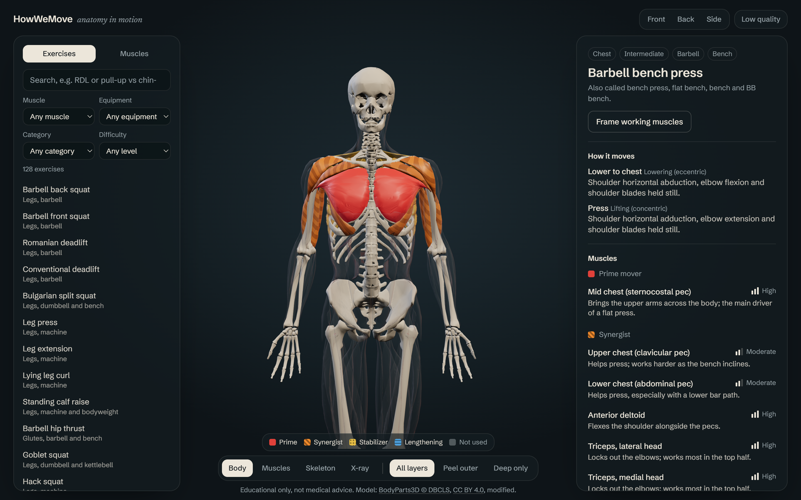
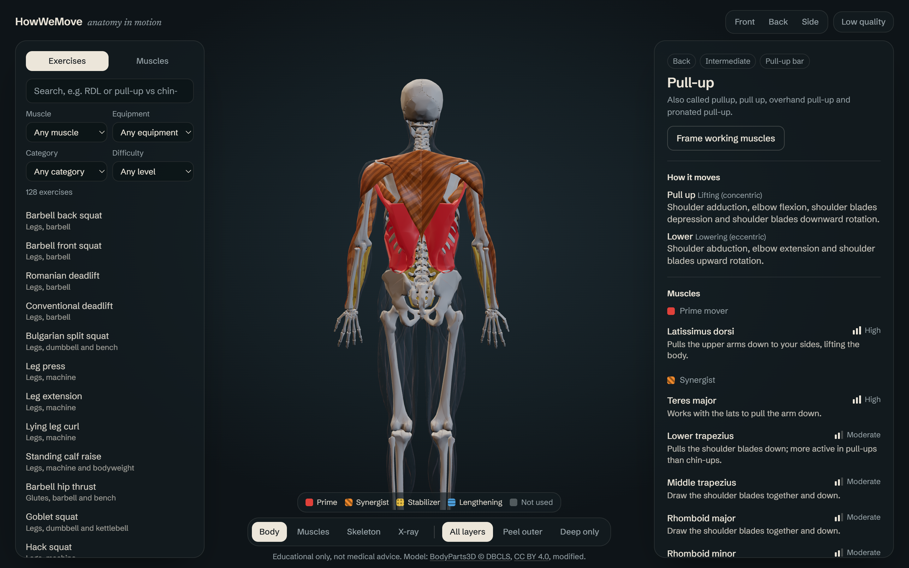
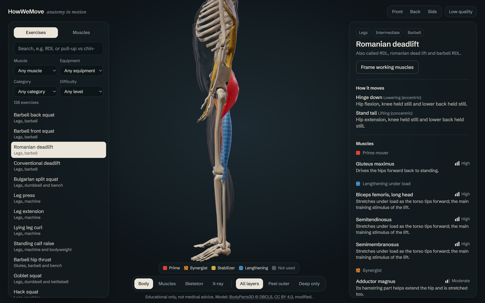
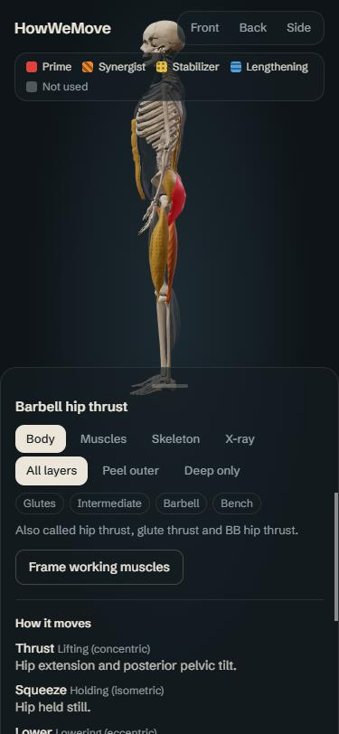

# Prime Mover

> **⚠️ View only — not open source.**
> This code is public for viewing only. Copying, modifying, deploying, redistributing or reusing any part of it (code, design, texts or branding), or using it to train AI models, is not allowed without written permission. See [LICENSE](LICENSE).

**See which muscles an exercise works, on a real 3D body.** Pick an exercise and the model lights up the muscles doing the work, colour-coded by role and ranked by how hard they work, with the research behind it.

**Live:** https://prime-mover.milos300399.workers.dev



## Made for trainers and their clients

Prime Mover is built to be shown, not just read. A personal trainer can pull it up on a phone, tablet or gym screen and answer "what is this actually working?" in seconds.

- **Explain an exercise.** Open it and the body shows the prime movers, the helpers, the muscles holding you steady and the ones being stretched. Every exercise lists the movement step by step, coaching cues, common mistakes with fixes, and variations.
- **Show why technique matters.** Notes explain what changes with grip, depth or stance. For example, the hamstrings lengthen under load in a Romanian deadlift, and a decline press shifts work to the lower chest.
- **Answer "what works my glutes?"** Filter by muscle, equipment, category or difficulty, or search by name, nickname or muscle ("RDL", "skull crusher", "latissimus"). Type "pull-up vs chin-up" to put both at the top of the results.
- **Use it on a phone.** The list sits in a sheet you pull up from the bottom, the body stays in view above it, and a tap on any muscle opens its details.
- **Share it.** Every exercise and muscle has its own link, so a trainer can send a client straight to their glute bridge or their rotator cuff.
- **Learn the anatomy.** Click or tap any muscle for what it does, where it attaches, which joints it crosses and which exercises work it. Peel away layers, switch to x-ray, or look from the front, back or side.

It also suits physio and sports-science students, coaches writing programmes, and anyone curious about how their body moves.

| Pull-up, from behind | Romanian deadlift, from the side | On a phone |
|---|---|---|
|  |  |  |

## What's inside

- **128 exercises**: strength, bodyweight, core, Olympic lifts, kettlebell, plyometrics and stretches.
- **86 muscles** on a full skeleton, built from the BodyParts3D anatomy database, with a **male and a female body** to switch between. The female body is the same anatomy reshaped to typical female proportions (wider pelvis, narrower shoulders, shorter stature), since no open female model with individual muscles exists.
- **Four roles**: prime mover, synergist, stabilizer and lengthening under load. Each has its own pattern as well as colour, so the roles stay readable for colour-blind viewers.
- **Three effort tiers** (high, moderate, low) instead of made-up percentages.
- **English and Serbian** (Latin script). Every exercise, muscle and bone name is translated, and English exercise names still work in the Serbian search.
- **Three themes**: the original slate, a neutral dark and a light one.
- **Evidence you can check.** Each exercise says how its muscle data is supported: measured with EMG (62 exercises), from related studies (34), or from anatomy (32). It cites the papers, 71 in total, each checked against PubMed or Crossref. See [docs/02-activation-evidence.md](docs/02-activation-evidence.md).

## Coming next

- 150+ exercises, side-by-side compare and a workout builder.

## Development

```sh
npm install
npm run dev      # Vite dev server on http://localhost:5173
npm test         # Vitest
npm run deploy   # build, then deploy to Cloudflare Workers (static assets)
```

Built with React, TypeScript, three.js (React Three Fiber), Zustand and Tailwind. The 3D model is built from BodyParts3D source data by the scripts in `pipeline/` (see `CLAUDE.md`).

Educational only, not medical advice.

## Credits

3D anatomy geometry adapted from **BodyParts3D, © The Database Center for Life Science, licensed under CC Attribution 4.0 International** (https://creativecommons.org/licenses/by/4.0/). Changes: selection of muscles and bones, unit and axis conversion, smoothing, decimation, generated muscles, and a landmark warp to typical female proportions for the female body.

## License

Copyright © 2026 Miloš Milinkov. All rights reserved.

This project is proprietary and **not** open source. No licence is granted to use, copy, modify, deploy or distribute it. See [LICENSE](LICENSE) for the full terms. For permission requests, contact milos300399@gmail.com.

Security issues: see [SECURITY.md](SECURITY.md).
